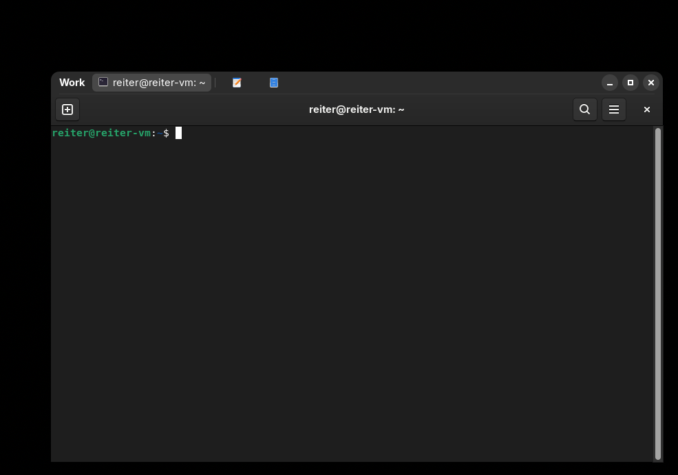
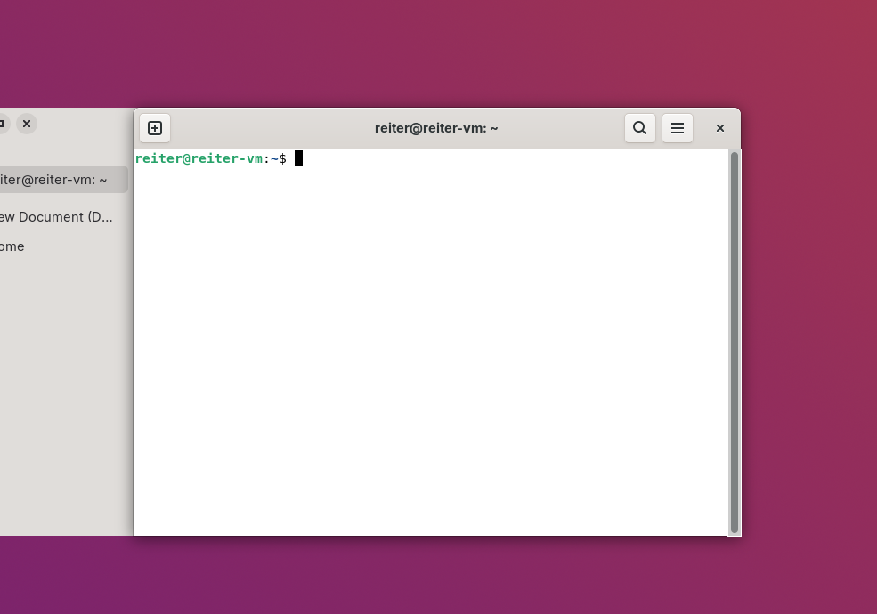
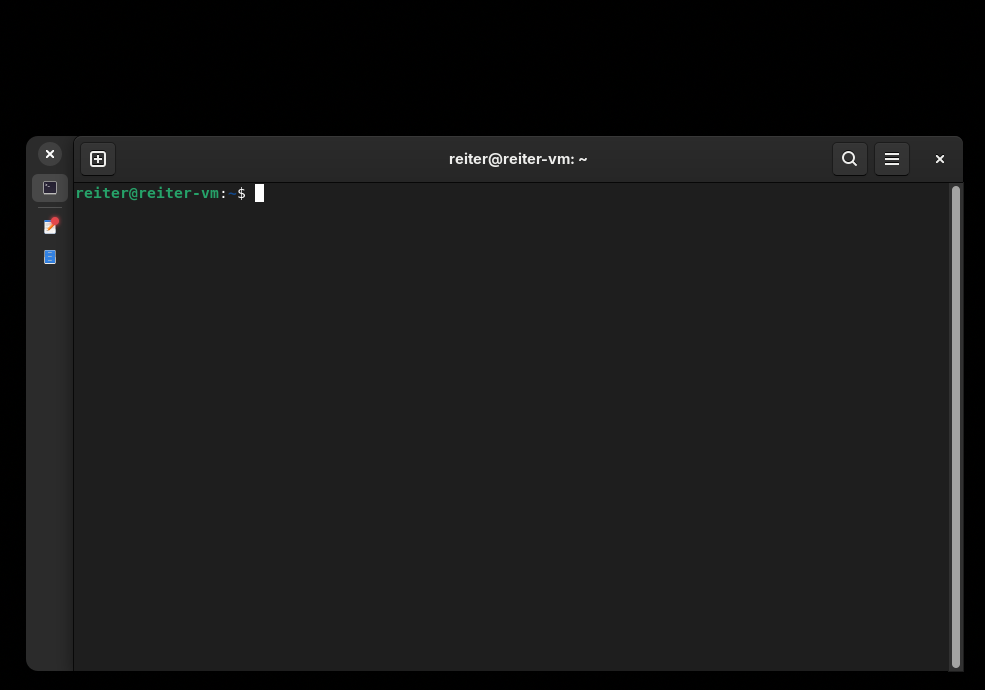
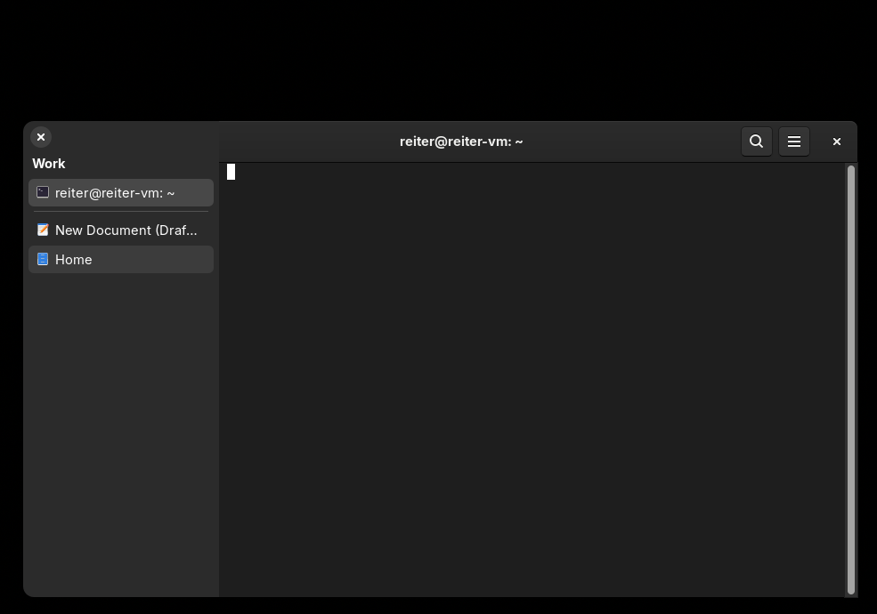
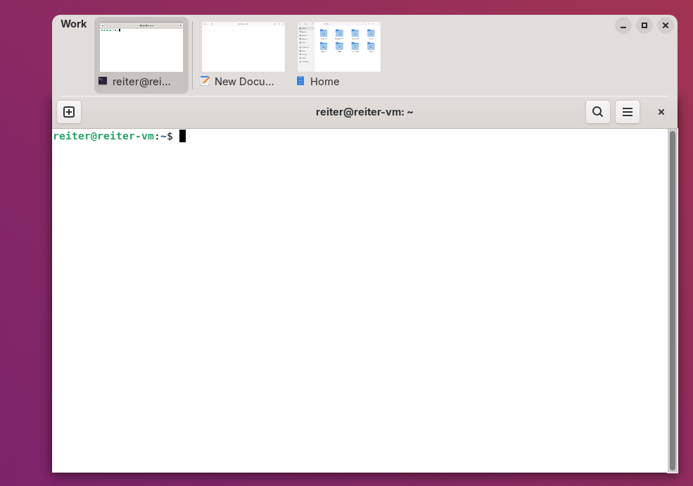
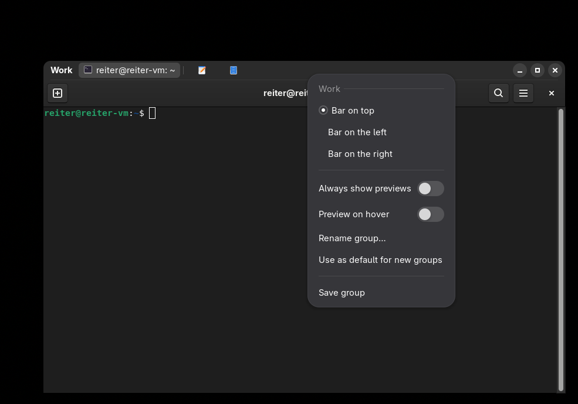

# Reiter

Reiter bundles windows of different apps into one group with a shared tab bar, in the spirit of
[WindowTabs](https://github.com/leafOfTree/WindowTabs) on Windows. A calendar, a mail client and a terminal
can share one frame: only the active window is shown, the others wait behind its tab.



## Features

**Grouping**
- Drag a window onto another window's tab bar to add it to the group. Drag a tab out of the bar to release it.
- `Super+G` groups the focused window with the window you used before.
- Rules: apps whose window classes you list in the preferences are grouped automatically when they open.
- Saved groups: a saved group reopens as a whole. Opening one of its apps starts the missing ones.
- Pinned tabs stay at the front of the bar, shown as an icon, with a thin divider after them.

**Bar**
- Position: top, left or right.
- Display: icons only, icon and title, or permanent live previews. A preview on hover works in every mode.
- Compact mode: a slim side bar that slides open over the window when the pointer touches it.
- Many tabs: the list scrolls and preview cards shrink to fit.
- The bar takes the color of the app's header bar and cross-fades when you switch tabs. It follows the
  light/dark setting.
- Window buttons of the group (minimize, maximize, close) sit on the outer corner of the bar and act on
  the whole group.
- Resize the group by its outer edges, resize the bar by its inner edge. Dragging the bar moves the group.

**Per group**
- Every group can have its own bar position, display mode, width, compact mode and a name.
- The settings are stored under the app combination of the group, so the same set of apps looks the same
  next time.
- "Use as default for new groups" copies a group's settings to the global defaults.

**Attention**
- A pulsing dot appears on a hidden tab when its app sends a notification or asks for attention.
  It disappears when you open the tab.

**Overview**
- A group appears as one window in the GNOME overview.



| Icons only, with attention dot | Compact, opened by hovering |
|---|---|
|  |  |



## Usage

| Action | How |
|---|---|
| Group the focused window with the previous one | `Super+G` (configurable in the preferences) |
| Add a window to a group | Drag its title bar onto the group's tab bar |
| Release a tab | Drag it out of the bar, or right-click it and choose "Open in own window" |
| Reorder tabs | Drag a tab along the bar |
| Switch tabs | Click a tab |
| Raise the group | Click anywhere on the bar |
| Move the group | Drag an empty part of the bar |
| Resize the group | Drag the outer edges of the bar or the window |
| Resize a side bar or the preview row | Drag the edge between bar and window |
| Bar and group settings | Right-click the bar |
| Pin / unpin a tab | Right-click the tab |
| Close one tab / the whole group | Right-click the tab and choose "Close" / use the close button of the bar |

The context menu is split in two parts. The first part ("This group", or the group's name) changes only
this group. Below it you find rename, "Use as default for new groups", "Back to default settings",
"Save group", and, on a tab, pin, release and close.



## Keyboard shortcuts

| Shortcut | Action |
|---|---|
| `Super+G` | Group the focused window with the last used one |

The shortcut can be changed in the extension preferences. There are no shortcuts for switching tabs yet:
`Ctrl+Tab`, `Ctrl+PageUp` and friends belong to the apps, so Reiter does not claim them.

## Installation

Requires GNOME Shell 50 or 51 on Wayland.

From a release archive:

```sh
gnome-extensions install --force reiter@hoever.cc.shell-extension.zip
```

Log out and back in (Wayland cannot reload shell code), then:

```sh
gnome-extensions enable reiter@hoever.cc
```

From source: copy or link the folder `reiter@hoever.cc` to `~/.local/share/gnome-shell/extensions/`,
run `glib-compile-schemas reiter@hoever.cc/schemas`, log out and in again.

## Preferences

Open them with `gnome-extensions prefs reiter@hoever.cc` or from the Extensions app. Rules are lists
of window classes, one rule per row, for example `org.gnome.Calendar, org.gnome.Evolution`. A window
class is what `xprop WM_CLASS` or Looking Glass (`Alt+F2`, `lg`) shows for a window.

## Known limits

- Tested on GNOME Shell 50.1 (Wayland) in a virtual machine. X11 sessions, several monitors and
  fractional scaling have not been tested.
- While groups exist, Reiter hides the window buttons of the apps' own header bars by changing the
  `button-layout` setting, and restores it when the last group closes or the extension is disabled.
- A group identifies its apps by window class. Two windows of the same app in the same group are not
  told apart by saved groups and per-group settings.
- `Alt+Tab` still lists the hidden windows of a group as separate entries.
- The terminal bell does not mark a tab. Under Wayland it sets no urgency hint; notifications do.

## Development

```sh
node --test test/group.test.js      # group logic, no shell needed
python3 tools/mkmo.py po/de.po reiter@hoever.cc/locale/de/LC_MESSAGES/reiter@hoever.cc.mo
```

The shell code runs only inside GNOME Shell. `tools/vm.sh` drives a test VM (libvirt, SSH over vsock):
deploy, log in again, send keys and clicks, take screenshots. See the header of the script.

Source layout: `extension.js` (shell side: bars, layout, events), `group.js` (group state without shell
imports), `prefs.js` (preferences), `schemas/` (GSettings), `po/` (translations), `stylesheet.css`.

Translations: English source strings, German in `po/de.po`. Other languages are welcome.

## License

GPL-3.0-or-later, see `LICENSE`.
